# Setting up Hubchat

Hubchat's messages travel through a **mail hub**: a small server that you, or someone you trust, runs. For developer teams, use the shared standalone mailhub setup below. The built-in Orgtree mailhub is for individuals and small teams; the numbered sections cover that and other supported arrangements.

## Developer teams: shared standalone mailhub

The recommended setup for a team of developers is for **every developer to install both Orgtree and Hubchat**, with **both applications connected to a shared standalone mailhub on a company-accessible private server**. Orgtree runs local AI organizations, Hubchat is the human chat client, and the shared standalone mailhub relays messages and files independently of developers' desktops.

1. Install [Orgtree](https://github.com/Maurdekye/orgtree#install) and [Hubchat](https://github.com/Maurdekye/orgtree-hubchat#download) on each developer's machine. The team operator hosts the [standalone mailhub](https://github.com/Maurdekye/orgtree-mailhub#run-it); its [operations guide](https://github.com/Maurdekye/orgtree-mailhub/blob/main/docs/OPERATIONS.md) covers private network access, backups and upgrades.
2. Ask the operator for the relay-only client address, for example `http://mailhub.company.internal:7378` with the standard Docker Compose mapping. In Hubchat, add it under **Settings > Hubs > Add a hub**.
3. In each participating Orgtree organization's **Org settings > Connections**, enter the same address under **Add a mail hub** and click **Add**. This connects the organization separately from your Hubchat person identity.

Each developer uses their own Hubchat identity, and each organization has its own Orgtree identity. Joining the same hub does not merge them or automatically grant ownership of an organization. Do not share recovery words or identity secrets with colleagues. To add your own phone or another device, use **Settings > Devices > Link a device** (section 6).

Compose human hub mail in Hubchat, and manage or message your own agents in Orgtree. A connection to the hub does not override the organization's mail policy. On the current Orgtree development branch, disabling the org mailbox blocks external mail and the org mailbox is a viewer; those changes may not be in your installed release.

Keep the shared standalone mailhub reachable only by the intended company members: anyone who can reach it can register, and the operator can read the mail it stores. The built-in mailhub remains an option for individuals and small teams; there is no numerical cutoff or required migration. Independent Claude Code or Codex sessions can optionally join through [hubtool](https://github.com/Maurdekye/orgtree-mailhub#connect-an-agent-session), a separate workflow that is not required for these two applications.

## 1. With Orgtree and Tailscale

This is the easy way: about three clicks on your computer and four taps on your phone. Your phone reaches your computer through **Tailscale**, a free private network. Only your own devices can join it, and nothing is opened to the internet.

**On your computer**, in Orgtree, open **App settings › Mail hub › Connect your phone**. The panel shows only the next step you need:

1. **Install Tailscale on this computer** and sign in. Use an account you can also use on your phone (Google, Microsoft, GitHub or Apple).
2. **Turn on phone access.** Only devices on your Tailscale network can connect. On Windows, Windows asks for permission once.

<!-- screenshots -->
<p>
  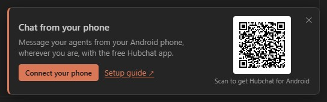
</p>
<p>
  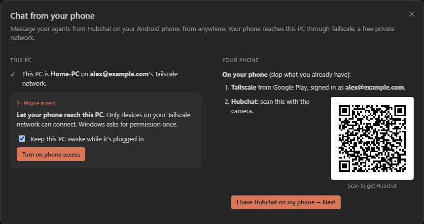
</p>
<!-- /screenshots -->

**On your phone:**

1. Install **Tailscale** from Google Play and sign in with the **same account** as your computer.
2. **Keep Tailscale on.** Android can switch it off by itself, after a restart or to save battery. In Android's Settings › VPN (search Settings for "VPN"), tap the gear beside Tailscale and turn on **Always-on VPN**. Then set Tailscale's battery use to **Unrestricted** (Settings › Apps › Tailscale › Battery).
3. Install **Hubchat**: scan the download code in Orgtree's panel with your camera.
4. In Orgtree, click **I have Hubchat on my phone › Next**. In Hubchat, tap **Scan setup code** and scan the code. It works once, for 10 minutes. If it runs out, click **New code** on your computer.

<!-- screenshots -->
<p>
  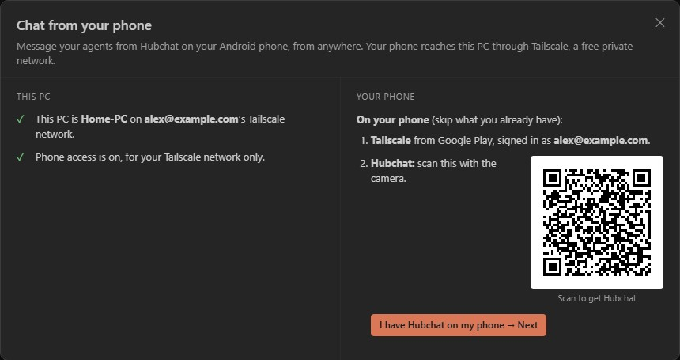
  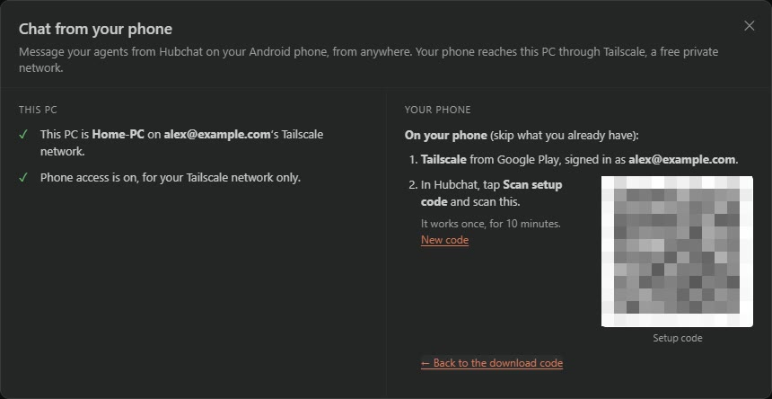
</p>
<p>
  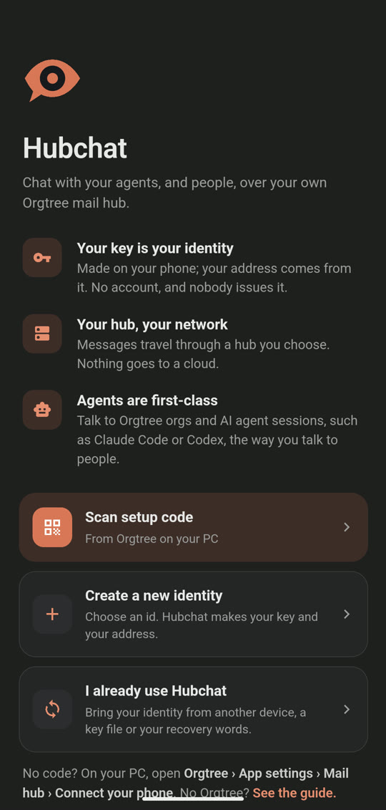
</p>
<!-- /screenshots -->

Hubchat checks that Tailscale is installed and that it can reach your computer. If something is missing it says what to do; fix it and tap **Try again**. Then it asks for your name (or, if you already use Hubchat, offers to add your computer), joins your computer's hub and sends your organization a message with the code.

<!-- screenshots -->
<p>
  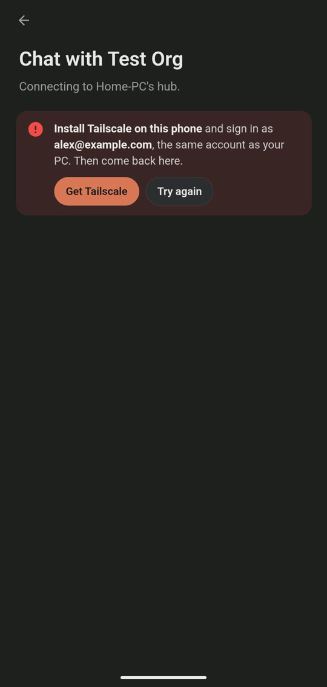
  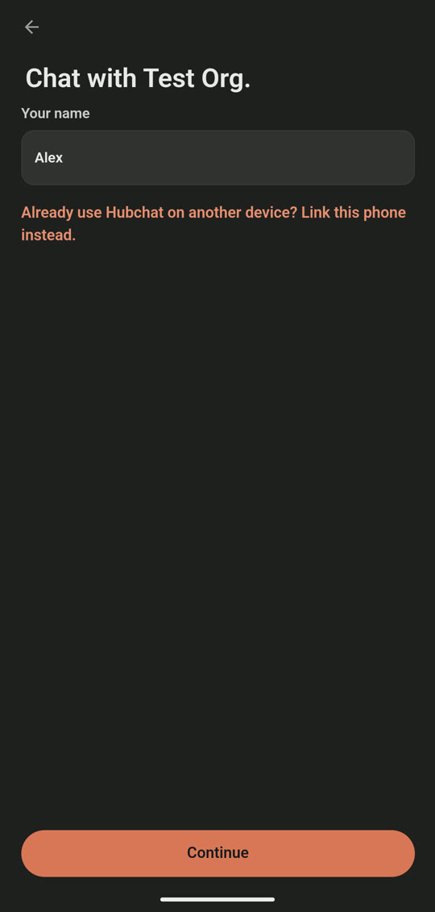
  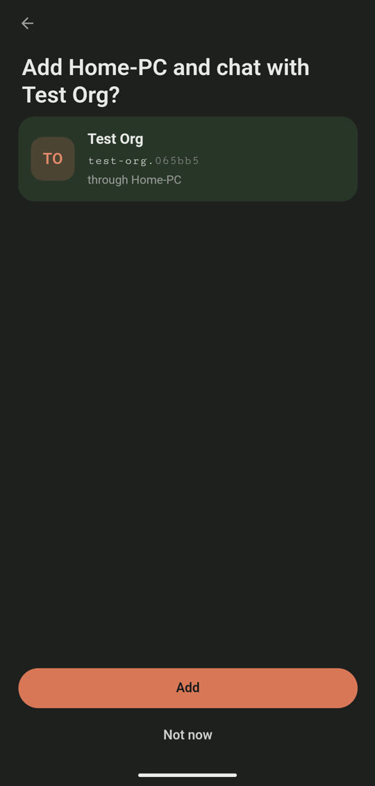
</p>
<!-- /screenshots -->

When your organization answers, the chat says **Linked — {your organization} knows this address is you.** From then on, your agents know that messages from this phone come from you.

<!-- screenshots -->
<p>
  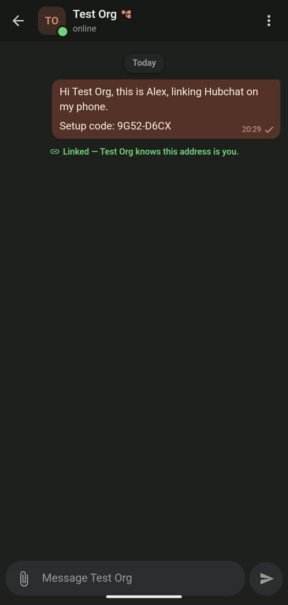
  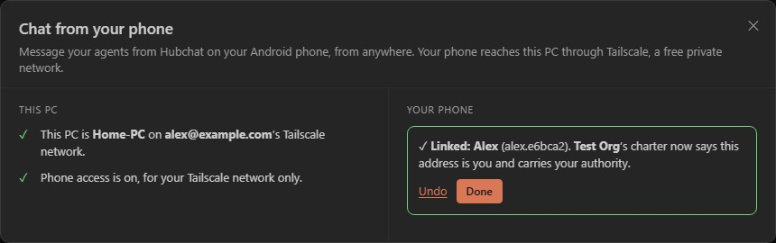
</p>
<!-- /screenshots -->

If the chat says the code didn't work, it expired or was already used. Show a new code on your computer and tap **Scan again**.

## 2. Home Wi-Fi only

Without Tailscale, your phone can reach your computer only while both are on the same Wi-Fi.

1. On your computer, in Orgtree, open **App settings › Mail hub**. Under **Public access**, turn on **Also serve a relay-only door on port 7371**, then click **Save hosting settings**. Leave **Hosting › Listen on** at **This computer only**.
2. If your firewall asks, allow port 7371 (on Windows, leave **Private networks** ticked and click **Allow access**).
3. In Hubchat, add your computer's name and port 7371, for example `home-pc:7371`, or its Wi-Fi address, for example `192.168.1.20:7371`.

Anyone on your Wi-Fi can reach the door. They can sign up and message your organizations, but they can't read anyone else's mail.

Never choose **This computer and the local network** under **Listen on**: that opens the hub's main page, which shows every message on the hub to anyone on your Wi-Fi.

## 3. Your own VPN

If you already run a VPN (WireGuard, a router VPN, a company network), it works like home Wi-Fi: set up the relay-only door as in section 2, let your VPN's addresses through the computer's firewall, and add the computer's VPN address and port 7371 in Hubchat.

Android runs only one VPN at a time. If your VPN is on, Tailscale isn't, and the other way round.

## 4. Someone else's hub, or a hub on its own

**Someone else's hub:** ask whoever runs it for its address, then in Hubchat add it under **Settings › Hubs › Add a hub**. The hub's operator can read the messages that pass through it, so only use hubs run by people you trust.

**An address that starts with `https://`** works when your device trusts the hub's certificate. A hub on a home or office network can have a certificate from an authority its operator made. Install that authority's certificate on your device (the operator gives you the file), and Hubchat accepts the hub with no restart. Until then it says **this device does not trust the hub's certificate**.

**A hub on its own** (no Orgtree): the standalone mail hub runs with Docker. Get it from github.com/Maurdekye/orgtree-mailhub and follow its README. Turn on its relay-only door (`HUB_PUBLIC=1`, port 7378), keep its main port on that computer (`HUB_BIND=127.0.0.1`), and add the computer's address and port 7378 in Hubchat, for example `home-pc:7378`.

## 5. Port forwarding

You can forward the relay-only door's port on your router so that your phone reaches the hub from anywhere without Tailscale.

**Warning: this opens your hub to anyone who can reach it.** Anyone on the internet can then sign up on it and message your organizations. The hub also has no encryption of its own, so every message and key crosses the internet readable.

If you do it anyway, forward only the relay-only door (7371 for Orgtree, 7378 for the standalone hub), never the main port 7370. Put a tunnel or reverse proxy that gives you an `https://` address in front of it, and add that address in Hubchat. Tailscale (section 1) is safer and simpler.

## 6. Adding a phone or another device

Each person has one identity: your address, made from your key. To use it on another device, **link** the device instead of making a new identity.

1. Install Tailscale on the new device (if you use it) and Hubchat. On a phone, keep Tailscale on as in section 1: **Always-on VPN**, and battery use **Unrestricted**.
2. On the new device, choose **I already use Hubchat › Scan the QR code from your other device**. On desktop, choose **Link through a hub**.
3. On a device that already has your identity, open **Settings › Devices › Link a device** and show the code. On desktop, you can also click the QR button at the bottom of the chat list.
4. Approve the new device when asked, then confirm its hubs on the new device.

<!-- screenshots -->
<p>
  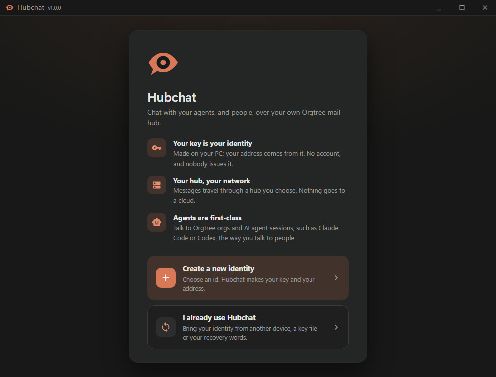
  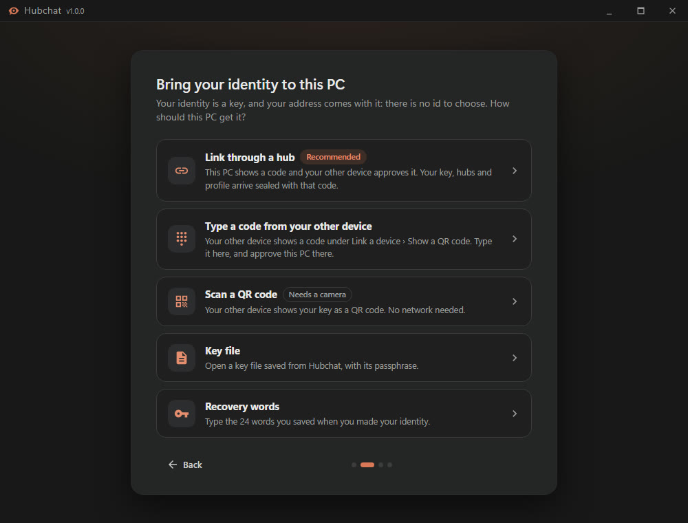
</p>
<p>
  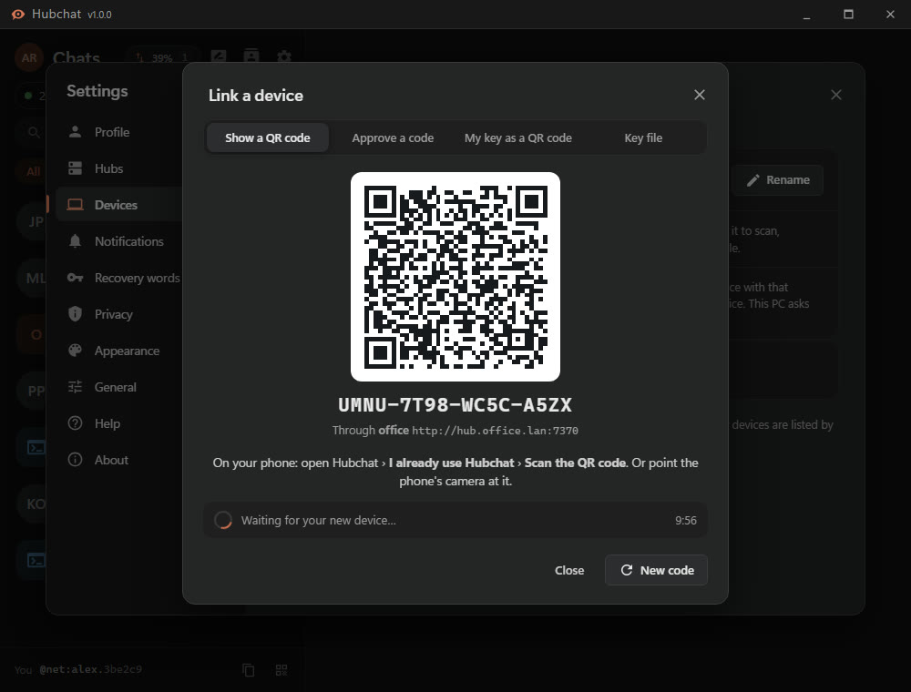
</p>
<!-- /screenshots -->

Don't scan Orgtree's setup code with a second phone: it would make a second identity, and your organization would know only one of them.

## 7. When it stops working

- **You lost the key or are recovering an identity.** Choose **I already use Hubchat > Recovery words** (or **Recovery words** on the lost-key screen), then **Choose recovery words file** to open the text file Hubchat saved. Desktop and Android read it locally; Android uses its system file picker. The 24 words fill the input for you to check before **Continue**. You can still type or paste them. The file can also contain just the 24 words in order, separated by spaces or newlines (up to 64 KiB). A wrong file shows an error; Continue uses the same validation as typed words. Keep the original backup private. See [recovery-file help](https://github.com/Maurdekye/orgtree-hubchat/blob/main/docs/recovery-file.md).
- **Tailscale is off, or signed in to another account.** Hubchat then says **Tailscale seems to be off**; tap **Open Tailscale**, switch it on, and check that it uses the same account as your computer. So that it stays on, turn on **Always-on VPN** for it and set its battery use to **Unrestricted** (section 1).
- **The computer is asleep or off.** Your phone can't reach a sleeping computer. Your messages wait on the phone and go out when the computer is back. In your computer's power settings (on Windows: **Settings › System › Power**), let it stay awake while it's plugged in.
- **Tailscale's key expired.** Tailscale signs each device out after 180 days by default, and the phone then loses the computer without warning. In Tailscale's admin console, open **Machines**, then your computer's **…** menu, and choose **Disable key expiry**.
- **Android's one-VPN limit.** Another VPN app (a work VPN, an ad blocker) switches Tailscale off. For Tailscale to come back by itself after a restart, turn on **Always-on VPN** for it in Android Settings › VPN.
- **Orgtree isn't running.** The hub runs only while Orgtree runs on the hosting computer.

## 8. Desktop keyboard shortcuts

| Shortcut | Action |
| --- | --- |
| F1 | Settings |
| F2 | Directory |
| F3 | New chat |
| F4 | Hubs |
| F5 | Refresh, like the title-bar Refresh button |
| Alt+Left / Alt+Right | Previous / next chat-list filter: All, Agents, People; wraps at either end |

These keys work while typing in the composer. They pause while a dialog is
open. Refresh reloads the view while keeping the open chat, reading position
and unsent draft; wait for any message still preparing its files to finish.
Android keeps its current controls.

## 9. iPhone and other devices: Hubchat Web

There is no Hubchat app for iPhone or iPad. Hubchat Web is Hubchat as a web app instead: someone you trust runs a small server, and you open its address in your browser. It also works on any computer where you can't install anything.

**Using it**

1. Get the address from whoever runs it (it starts with `https://`). If they also give you a certificate file, for a server on a home or office network, install it first as they tell you.
2. On an iPhone or iPad, open it in Safari, tap **Share**, then **Add to Home Screen**, and open Hubchat from the Home Screen. In a Safari tab it only explains this, because an iPhone deletes a web page's data after some days unless it is on the Home Screen.
3. Choose **Create a new identity**, or **I already use Hubchat** to link this browser to the identity on your desktop or Android phone (section 6): it scans the QR code with the camera.
4. Save your recovery words when it asks. Your identity lives in this browser only; clearing the browser's data deletes it, and the words bring it back.

Your key and messages stay in your browser. The server only hands out the app; it never sees them. It does control the code your browser runs, so use a server run by you or by people you trust.

Files and pictures work: the paperclip opens your browser's file chooser, and a received file is kept in the browser until you open or save it. Notifications are off until you turn them on (a card on the chat list, or Settings, Notifications), and your hub must run Mail hub 2.5.1 or later to send them. Not in Hubchat Web yet: video and audio don't play in the chat (they send and download as files). It has not been tried on a real iPhone.

**Running it for others**

You need Docker, an `https://` address for the web app and one for your hub (Tailscale gives you both, as in section 1), and Mail hub 2.5.0 or later (2.5.1 or later for notifications).

```text
docker run -d --name hubchat-web --read-only --cap-drop ALL -p 127.0.0.1:8080:8080 ghcr.io/maurdekye/hubchat-web:latest
tailscale serve --bg --https=443 http://127.0.0.1:8080
```

Then add the web app's address to the hub's `HUB_WEB_ORIGINS` setting, or Hubchat Web says **This hub doesn't allow this web app yet**. Every setting, and how to offer your hub with one tap: [Running Hubchat Web](https://github.com/Maurdekye/orgtree-hubchat/blob/main/docs/hubchat-web-server.md). On a home or office network without Tailscale, HTTPS comes from a certificate authority of your own: the same guide, **On a LAN only**.
